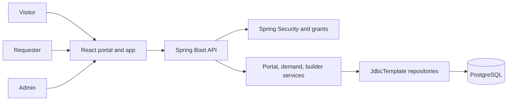

# Proposed architecture

One frontend/API/database. Public routes read published versions. Requester routes derive owner from session. Admin routes check explicit grants. Demand service calls canonical database transition routine after grant check. Builder JSON validated against allowlist; draft/published pointers differ; optimistic revisions prevent lost writes. Auth, demand forms and decisions are fixed components. Paginate lists, index owner/status/time, limit JSON size, reject executable content.

ADR-001: React/Spring/PostgreSQL/Flyway follows builder conventions. ADR-002: one identity/persistence system. ADR-003: capacity per demand. ADR-004: DB routine owns status/audit atomicity. ADR-005: only content pages fully editable. ADR-006: demo seed separate from migrations. DB roles and application grants are separate.
