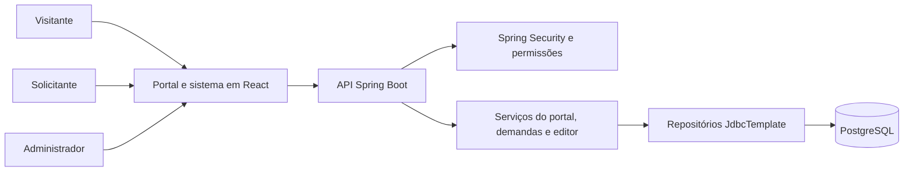

# Arquitetura proposta

## Visão geral

A solução terá um único frontend, uma única API e um único banco de dados.

- **Rotas públicas** exibem apenas as versões publicadas das páginas do portal.
- **Rotas do solicitante** identificam o dono dos dados pela sessão autenticada; o solicitante nunca informa de quem é a demanda.
- **Rotas administrativas** verificam permissões explícitas antes de qualquer ação.
- **Mudança de situação de uma demanda:** o serviço verifica a permissão do usuário e chama a rotina do banco de dados responsável pela transição, que grava a nova situação e o histórico em uma única operação.
- **Editor de páginas:** o conteúdo (JSON) é validado contra uma lista de blocos permitidos. Rascunho e versão publicada são separados, e o controle de revisões evita que uma edição sobrescreva outra.
- **Componentes fixos:** autenticação, formulários de demanda e telas de decisão não são editáveis pelo editor de páginas.
- **Desempenho e segurança:** listas paginadas; índices por dono, situação e data; limite de tamanho do JSON; rejeição de conteúdo executável.

## Decisões de arquitetura (ADR)

| ADR | Decisão |
|---|---|
| ADR-001 | React, Spring Boot, PostgreSQL e Flyway, seguindo as convenções do `web-builder` |
| ADR-002 | Um único sistema de identidade e de persistência |
| ADR-003 | A condição do solicitante (empreendimento, fórum, instituição parceira, outros) é registrada em cada demanda, não na conta |
| ADR-004 | A rotina do banco de dados é responsável por mudar a situação e gravar o histórico de forma atômica |
| ADR-005 | Apenas as páginas de conteúdo do portal são totalmente editáveis |
| ADR-006 | Os dados de demonstração ficam separados das migrações |

Os papéis do banco de dados (usados pela aplicação para se conectar) são diferentes das permissões dos usuários dentro do sistema.
